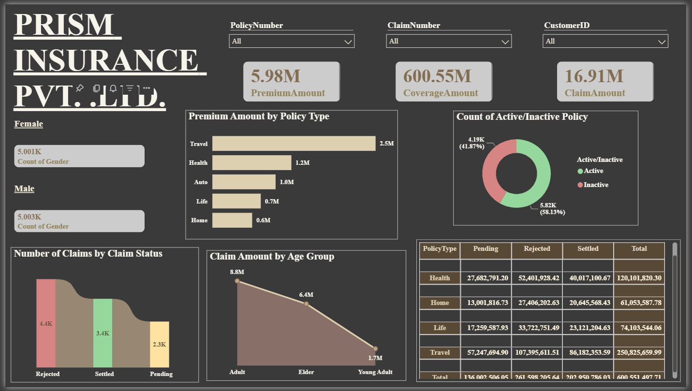
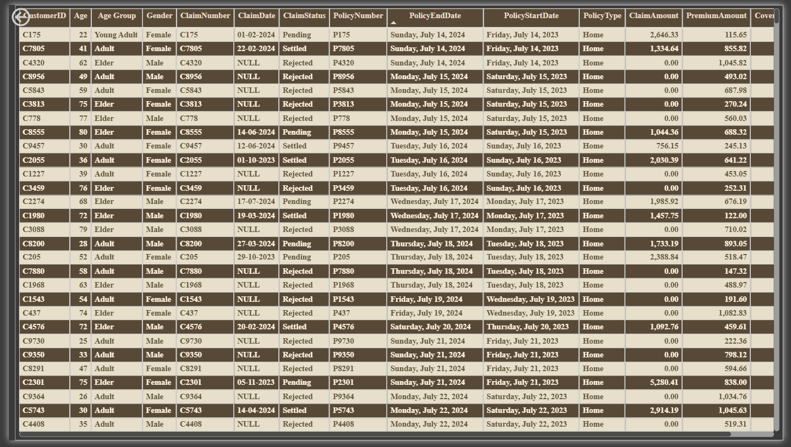

# 🏥 Insurance Data Analysis Dashboard | SQL Server & Power BI


An end-to-end data analytics project focused on analyzing insurance data, claim status, and policy performance. The project uses SQL Server for database creation, data exploration, and record validation, with Power BI for interactive reporting and visualization of insurance claims and premium amounts across different policy types.

---

## Table of Contents

- [About the Project](#about-the-project)
- [Technologies Used](#technologies-used)
- [Dataset](#dataset)
- [Project Objectives](#project-objectives)
- [Project Workflow](#project-workflow)
- [SQL Analysis](#sql-analysis)
- [Power BI Dashboard](#power-bi-dashboard)
- [Key Findings](#key-findings)
- [Business Recommendations](#business-recommendations)
- [How to Run](#how-to-run)
- [Project Structure](#project-structure)
- [Future Improvements](#future-improvements)
- [Author](#author)

---

## About the Project

The objective of this project is to explore insurance data and build a Power BI dashboard that helps users understand claim distribution and premium amounts across different policy types.

SQL Server is used to create the database, access the insurance dataset, inspect records, and validate the total number of records. Power BI is used to present insurance-related metrics through visualizations that make it easier to explore claim statuses and policy-level premium information.

This project demonstrates practical skills in SQL querying, database management, data exploration, data visualization, and business intelligence reporting.

---

## Technologies Used

- **SQL Server** — database creation, table access, and data exploration.
- **SQL Server Management Studio (SSMS)** — executing SQL queries and managing the database.
- **Microsoft Power BI Desktop** — interactive dashboard development and data visualization.
- **SQL** — database selection, retrieving records using `SELECT`, and counting records using `COUNT()`.
- **CSV or Excel** — source data storage, if applicable to the original dataset.

---

## Dataset

The project uses an insurance dataset stored in the SQL Server table `InsuranceData`.

The dataset supports analysis of insurance claims and premium amounts across different policy types.

### Key Analytical Fields

| Field / Metric | Purpose |
|---|---|
| Claim Status | Analyze the distribution of claims across different statuses. |
| Policy Type | Compare insurance premium amounts across policy types. |
| Number of Claims | Examine claim counts by claim status. |
| Premium Amount | Evaluate premium amounts across policy types. |

**Data note:** These are the analytical fields and metrics indicated by the provided dashboard. The complete column names, total record count, date range, and data types should be verified against the source table before being documented.

---

## Project Objectives

- Create a SQL Server database for insurance data analysis.
- Retrieve and inspect records from the insurance dataset.
- Calculate the total number of records in the dataset.
- Analyze the number of claims by claim status.
- Compare premium amounts across different policy types.
- Build a Power BI dashboard to communicate insurance-related metrics.
- Identify potential areas for further investigation using the dashboard.

---

## Project Workflow

1. **Database Creation:** Created the `Insurancedb` database in SQL Server.
2. **Database Selection:** Selected the database using the `USE` statement.
3. **Data Exploration:** Retrieved records from the `InsuranceData` table.
4. **Record Validation:** Counted the total number of records using `COUNT()`.
5. **Data Visualization:** Used Power BI to visualize claim status and premium amounts by policy type.
6. **Business Analysis:** Used the dashboard to explore claim distribution and premium-related patterns.

---

## SQL Analysis

The SQL script covers the initial stages of database setup and data exploration.

### 1. Create the Database

```sql
CREATE DATABASE Insurancedb;

USE Insurancedb;
```

Creates the database and selects it for subsequent queries.

### 2. Retrieve Insurance Data

```sql
SELECT *
FROM [dbo].[InsuranceData];
```

Retrieves all columns and records from the insurance dataset for inspection.

### 3. Count Total Records

```sql
SELECT COUNT(*) AS [Total Count]
FROM InsuranceData;
```

Counts the total number of records in the table, providing a basic validation of the imported dataset.

### SQL Skills Demonstrated

- Database creation and selection.
- Retrieving records using `SELECT`.
- Accessing tables using schema-qualified names.
- Counting records using `COUNT(*)`.
- Inspecting a dataset before further analysis.

**Note:** The current SQL script covers basic database exploration. Additional cleaning, joins, aggregations, and advanced queries should only be documented if they are implemented in the project.

---

## Power BI Dashboard

The Power BI report presents insurance metrics through visualizations focused on claim status and premium amounts.

### 1. Number of Claims by Claim Status

This visualization examines the number of claims associated with each claim status.

**Analytical focus:**

- Compare claim counts across different statuses.
- Understand the distribution of claims.
- Identify statuses that may require further investigation.

### 2. Premium Amount by Policy Type

This visualization compares premium amounts across different policy types.

**Analytical focus:**

- Compare premium amounts between policy categories.
- Identify differences in premium contribution.
- Support further investigation of policy-level performance.

### Dashboard Screenshots

Add screenshots of your actual Power BI report to the `screenshots/` folder.

#### Claims by Status



#### Premium Amount by Policy Type



**Note:** The image paths above are placeholders. Save your actual screenshots using these filenames, or update the references to match your chosen filenames.

---

## Key Findings

The dashboard supports analysis of the following questions:

- How are insurance claims distributed across claim statuses?
- Which claim statuses account for the highest and lowest claim counts?
- How do premium amounts vary across policy types?
- Which policy types contribute the largest premium amounts?

Actual numerical findings should be added after reviewing the dashboard values. No specific claim counts, premium totals, or policy rankings are assumed in this README.

---

## Business Recommendations

The dashboard can support the following potential business actions, depending on the results observed:

- **Claims monitoring:** Review claim statuses with unusually high counts to identify areas requiring further investigation.
- **Claims processing:** Investigate whether pending or delayed claims require operational attention, if these statuses exist in the dataset.
- **Premium analysis:** Compare premium amounts across policy types to understand differences in premium contribution.
- **Performance monitoring:** Track claim distribution and premium metrics to support regular reporting.
- **Further investigation:** Combine claim status and policy information with additional fields to understand the factors associated with claim patterns.

These are potential recommendations, not confirmed business outcomes. Final recommendations should be based on verified dashboard findings and relevant business context.

---

## How to Run

### 1. Clone the Repository

```bash
git clone YOUR_GITHUB_REPOSITORY_URL
```

Alternatively, download the repository as a ZIP file from GitHub and extract it.

### 2. Set Up SQL Server

Open SQL Server Management Studio and execute the database creation statement:

```sql
CREATE DATABASE Insurancedb;

USE Insurancedb;
```

Ensure that the `InsuranceData` table has been imported into the database before executing the remaining queries.

### 3. Execute the SQL Queries

Run the queries to retrieve the insurance records and calculate the total record count.

Verify that the database and table names match those used in the SQL script.

### 4. Open the Power BI Report

Open the project's `.pbix` file using Microsoft Power BI Desktop.

If the report prompts you to reconnect to a data source, update the source path or database connection settings as required.

### 5. Refresh and Explore the Dashboard

Refresh the data if necessary, verify that the visuals load correctly, and explore claim status and premium amounts by policy type.

### 6. Add Screenshots to GitHub

1. Open the report in Power BI Desktop.
2. Navigate to the relevant report page.
3. Capture screenshots of the actual visualizations.
4. Save them in the `screenshots/` folder.
5. Update the image references in this README if necessary.
6. Commit and push the changes to GitHub.

---

## Project Structure

```text
Insurance-Data-Analysis-Dashboard/
│
├── README.md
├── Project-2.pbix
│
├── data/
│   └── InsuranceData.csv
│
├── sql/
│   └── Insurance_Analysis.sql
│
└── screenshots/
    ├── claims-by-status.png
    └── premium-by-policy-type.png
```

**Note:** This is a suggested structure. Adjust the filenames and folders to match the files actually present in your repository. The dataset and SQL file shown above are examples of expected project organization, not confirmed uploaded files.

---

## Future Improvements

- Add data-quality checks for missing values, duplicate records, and invalid values.
- Document the dataset's row count, column definitions, and data types.
- Use SQL aggregation queries to calculate claim counts and premium totals by category.
- Add further KPIs for claim processing and premium performance where supported by the data.
- Incorporate time-based analysis if date fields are available.
- Document Power BI measures and data transformation steps.
- Add verified business findings and numerical insights to the dashboard documentation.
- Improve dashboard interactivity with additional filters and drill-through analysis where appropriate.

---

## Author

**Aakanksha Haravde**

Aspiring Data Analyst | SQL Server | Power BI | Data Analytics | Business Intelligence
